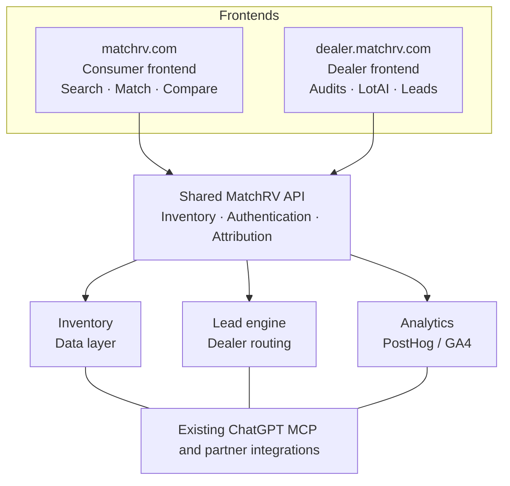

# MatchRV domain split

Two frontends, one server. `https://matchrv.com` is the consumer RV marketplace. `https://dealer.matchrv.com` is the dealer site. Inventory, authentication, lead attribution, and the ChatGPT MCP stay on the shared API. Nothing in this change alters those public contracts, and nothing here changes production DNS.

Jonathan's diagram:

The browser picks a shell from the hostname. The API 301s a migrated HTML page to the host that owns it, and it serves that host's prerendered HTML, canonical, and sitemap. `/api/*`, `/mcp`, `/.well-known/*`, and `/ops/*` are not pages. They answer on whichever host received the request, and they are never redirected.

Read next:

- [URL migration matrix](URL-MIGRATION-MATRIX.md)
- [Rollback](ROLLBACK.md)
- [DNS, Caddy, and Render](DNS-AND-HOSTING.md) — documentation only; no records were changed
- [Search Console](SEARCH-CONSOLE.md) — documentation only; no Search Console settings were changed
- [Analytics](ANALYTICS.md)
- [Category and location pages still to build](P2-CATEGORY-PAGES.md)
